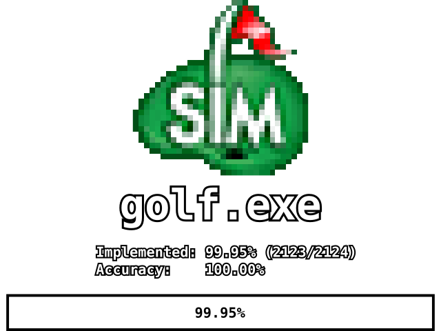
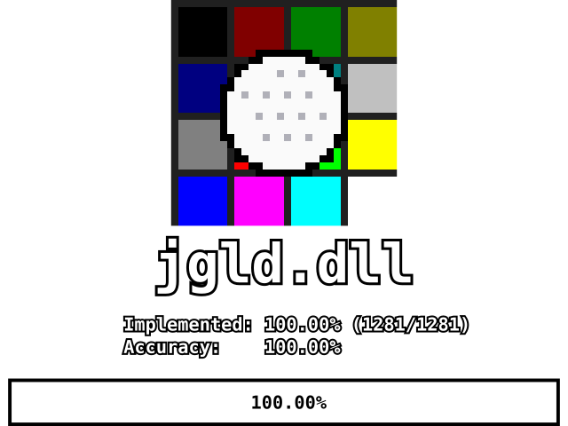
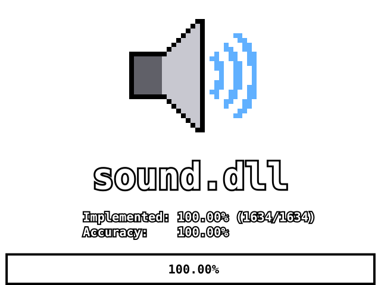
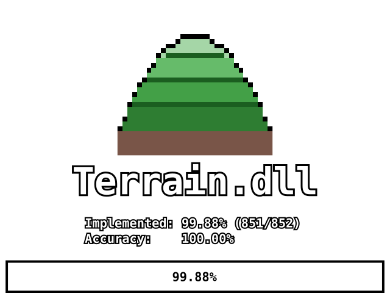

# Sid Meier's SimGolf Decompilation

[Contributing](/CONTRIBUTING.md)

This is a complete decompilation of Sid Meier's SimGolf (Version 1.03, English). It aims to be as accurate as possible, matching the recompiled instructions to the original machine code as much as possible. The goal is to provide a workable codebase that can be modified, improved, and ported to other platforms later on.

> **Note:** This repository is for decompilation only and its code is true to the original release. It will not compile for targets other than 32-bit Windows.

## Status

<a href="https://smsg-decomp.github.io/SMSG-decomp/GOLFPROGRESS.HTML"></a><a href="https://smsg-decomp.github.io/SMSG-decomp/JGLDPROGRESS.HTML"></a><a href="https://smsg-decomp.github.io/SMSG-decomp/SOUNDPROGRESS.HTML"></a><a href="https://smsg-decomp.github.io/SMSG-decomp/TERRAINPROGRESS.HTML"></a>

| Binary | smsg accuracy report | smsg verification report |
| --- | --- | --- |
| `golf.exe` | [GOLFPROGRESS.HTML](https://smsg-decomp.github.io/SMSG-decomp/GOLFPROGRESS.HTML) | [GOLF target result](https://smsg-decomp.github.io/SMSG-decomp/report.html#targets) |
| `jgld.dll` | [JGLDPROGRESS.HTML](https://smsg-decomp.github.io/SMSG-decomp/JGLDPROGRESS.HTML) | [JGLD target result](https://smsg-decomp.github.io/SMSG-decomp/report.html#targets) |
| `sound.dll` | [SOUNDPROGRESS.HTML](https://smsg-decomp.github.io/SMSG-decomp/SOUNDPROGRESS.HTML) | [SOUND target result](https://smsg-decomp.github.io/SMSG-decomp/report.html#targets) |
| `Terrain.dll` | [TERRAINPROGRESS.HTML](https://smsg-decomp.github.io/SMSG-decomp/TERRAINPROGRESS.HTML) | [TERRAIN target result](https://smsg-decomp.github.io/SMSG-decomp/report.html#targets) |

The smsg accuracy reports compare every recompiled function with the original
binary. The smsg verification report records the cold rebuild of all four
binaries, compares each with the original byte for byte, and links its full
`report.json` record; `smsg verify` and `smsg report --pages`, in the project's
own tooling (not published), regenerate both.

`golf.exe`, `jgld.dll`, `sound.dll` and `Terrain.dll` are completely
decompiled: every function compiled from this source matches the original's
instructions. The project's verification build uses the original Microsoft
Visual C++ 6.0 toolchains, without a service pack and with Service Pack 5. No
binary is the original file byte for byte: the three libraries were linked
incrementally, with an edit-and-relink history that cannot be recovered from
source, and golf.exe's link order was not recovered. No further work is
planned.

## Building

There are two build paths:

- `build.bat` with `EXACT=1` reproduces the reference build;
  [The Build Lock](/CONTRIBUTING.md#the-build-lock) says how to check it.
- The ordinary Visual C++ 6.0 build is useful for day-to-day development, but
  its outputs are not certified.

### Reproduce the original binaries exactly

Start with a fresh checkout at `C:\SimGolf\decompilation`, with its submodules
(`git clone --recurse-submodules`). macOS and Linux also need Wine (or see
[Docker](#docker)), with `toolchain\vc6sp2\VC98\redist\msvcrt.dll` in the
prefix's `system32` and `WINEDLLOVERRIDES=msvcrt=n` set. Create the original
teams' directories below as directory junctions (`mklink /J`) to this tree,
then run these commands from the repository root:

```bat
set EXACT=1
build.bat
```

| Directory | Points at |
| --- | --- |
| `C:\Program Files\Microsoft Visual Studio` | `toolchain\vc6` |
| `C:\SimGolf\golf` | `golf` |
| `C:\Projects\3DTerrainLowPoly` | `terrain\Terrain.dll` |
| `C:\JackDev` | `jgl\jgld.dll` |
| `C:\libpng.lib` | `jgl\libpng.lib` |
| `C:\zlib.lib` | `jgl\zlib.lib` |
| `C:\SimGolf\external\jpeg-6a` | `golf\jpeg.lib\jpeg-6a` |
| `C:\SimGolf\external\lpc10-1.5` | `sound\lpc10.lib\lpc10\lpc10-1.5\lpc55-C` |
| `C:\SimGolf\external\bink` | `golf\binkw32.lib` |
| `C:\DXSDK` | `sound\DXSDK` |

The compiler's output depends on the names of these directories, so the build
must use them. `EXACT=1` stops unless every one exists, then builds everything
from scratch with the toolchain each binary shipped with. A successful run
writes `golf\golf.exe\Release\golf.exe`, `sound\sound.dll\Release\sound.dll`,
`terrain\Terrain.dll\Debug\Terrain.dll` and `jgl\jgld.dll\Debug\jgld.dll`.
Use the IDE for faster incremental builds while editing, then run `build.bat`
with `EXACT=1` before sharing a result.

The project's own verification build (`smsg verify`, not published) ran the
same build from a fresh clone under Wine, compared each binary with the
original and wrote the verification report linked above. To check your
outputs, follow [The Build Lock](/CONTRIBUTING.md#the-build-lock). The ordinary
instructions below remain useful for development builds, but only the exact
build reproduces the recorded outputs.

### Ordinary developer build

This project uses Visual C++ 6.0's own build system, as the original teams did:
one workspace (`.dsw`) per component and one project (`.dsp`) per binary.
Visual C++ 6.0 is the original game's compiler and the only one this tree
builds with.

#### Prerequisites

You will need the following software installed:

- Git, to check out the toolchains and the third-party code as submodules.
- clang-format 23.1.3, exactly. `build.bat` checks the formatting before it compiles anything; `build.bat format` fixes it. It is in the LLVM 23.1.3 release or `pip install clang-format==23.1.3`; `CLANGFORMAT` names it when it is not on the `PATH`.

Everything else is a submodule:

- Microsoft Visual C++ 6.0, three times: `toolchain\vc6` without a service pack, `toolchain\vc6sp5` with Service Pack 5 (sound.dll and `binkw32`), and `toolchain\vc6sp2` with Service Pack 2, for its LIBCMTD.LIB and the MSVCRT.DLL and MFC42.DLL the tools run on. `VC6`, `VC6SP5` and `VC6SP2LIB` name installations instead.
- The IJG JPEG library, libpng, zlib and LPC-10, inside the projects that build them, and the DirectX 8.0 SDK at `sound\DXSDK` (`DXSDK` names an installation instead).

Microsoft no longer distributes Visual C++ 6.0 or the DirectX 8.0 SDK; the submodules check out public copies, which are not part of this repository and keep Microsoft's licence.

#### Compiling

1. Open the workspace of the component you want to build in Visual C++ 6.0: `golf/golf.dsw`, `jgl/jgl.dsw`, `sound/sound.dsw` or `terrain/terrain.dsw`.
1. Set the include and library directories (Tools > Options > Directories) for that binary, as `build.bat` lists them.
  - **Use the right compiler for each binary**: Service Pack 5 for sound.dll and `binkw32`, no service pack for the rest.
  - **Visual C++ 6.0 has issues with paths containing spaces**. If you get build errors, make sure the repository is not in a path that contains spaces.
1. Select the configuration each binary shipped as: `Release` for golf.exe and sound.dll, `Debug` for Terrain.dll and jgld.dll.
1. Build with F7: Terrain.dll and `binkw32` before golf.exe, and `lpc10.lib` before sound.dll.
1. When this is done, there should be recompiled `golf.exe`, `sound.dll`, `Terrain.dll` and `jgld.dll` files in each project's `Release` or `Debug` directory.

`build.bat` runs the same builds from the command line: `build.bat` for all four, or `build.bat golf` (or `terrain`, `jgl`, `sound`) for one.

### Docker

Alternatively, we support Docker as a method of compilation. This is ideal for users on Linux and macOS who do not wish to manually configure a Wine environment for compiling this project.

Compilation should be as simple as building the image once and running the following command:

```console
docker build -t simgolf docker
docker run -d \
	-e EXACT=1 \
	-v <path-to-source>:/simgolf:rw \
	simgolf
```

`<path-to-source>` should be replaced with the path to the source code directory (ie: the root of this repository), checked out with its submodules.
The container takes `build.bat`'s verb as its argument and exits with its status; leave out `EXACT=1` for an ordinary build.

## Usage

The simplest way to use the recompiled binaries is to swap the original files (`golf.exe`, `sound.dll`, `Terrain.dll` and `jgld.dll`) in SimGolf's installation directory for the ones that you've built from this source code.

For advanced users, you can get SimGolf to run from anywhere as long as `golf.exe`, its three libraries and `binkw32.dll` are in the same directory as the game's data directories (`data`, `flics`, `sounds` and the others). None of the four binaries reads the registry.

If you see an error about DirectPlay, you will need to enable it (Windows Features, Legacy Components, DirectPlay), as newer versions of Windows install it only on request.

## Contributing

If you're interested in helping or contributing to this project, check out the [CONTRIBUTING](/CONTRIBUTING.md) page.

## Additional Information

### Which version of SimGolf do I have?

None of SimGolf's four binaries carries a version number, so look at the dates they were linked on. The 1.03 update's `golf.exe` was linked on March 29, 2002, and the three libraries in December 2001. With SafeDisc's protection removed, `golf.exe` is 2,286,953 bytes, of which the program is the first 954,368.

This decompilation specifically targets the English release of version 1.03 of SimGolf. You can verify you have the correct version using the checksums below:

* golf.exe `md5: c6c7da79f2b88d609b357c7998f1a860` (with SafeDisc removed; its first 954,368 bytes: `md5: b68e7ebc61e59a333a0467e0fe129a81`)
* jgld.dll `md5: 9fbecb5baa3586947af082483ec25b55`
* sound.dll `md5: 93f8b776945a0c07907136a1984e66fd`
* Terrain.dll `md5: 31bfda31e8214f6f00e73e5dc52851b8`

## Credits

SimGolf is the work of the team at Firaxis Games, with Maxis and Electronic Arts. This project only reconstructs their source; all credit for the game goes to them and their hard work. The credits below are reproduced from the game's own credits file.

### Firaxis Games

**Design**
- Sid Meier

**Programming**
- Sid Meier
- Jacob Solomon
- Javier Sobrado
- David McKibbin

**Art**
- Greg Cunningham, Lead
- Greg Foertsch
- Steve Chao
- Marc Hudgins
- Dennis Moellers
- Ryan Murray
- Alex Kim
- Kevin Margo
- Dorian Newcomb
- Mike Bazzell

**Music & Audio**
- Mark Cromer

**Production**
- Mike Gibson
- Michael Fetterman

**Firaxis Marketing**
- Lindsay Riehl
- Kelley Gilmore
- Dan Magaha

**Additional Art**
- Jon Marro, Intern
- Megan Quinn, Intern
- Justin Thomas, Intern
- Zach Wilson, Intern
- Rick Kolesar
- Tracy Smith

**Additional Programming**
- Pat Dawson
- Jon Armoza, Intern

**Product Testers - AQI**
- Clint McCaul
- John Kuhn
- Debby Dillon
- Scott Kramperth

**Special Thanks**
- Barry Caudill
- Ellie Crawley
- Jim Crawley
- The Swing Central Band:
  - Mark Cromer
  - David Smith
  - Nathan Reynolds
  - Emanuel Coleman

**Firaxis Would Also Like to Thank**
- Our Families, including:
  - Ryan Meier
  - Alisha "Eeka" Vincent
  - Barbara Merrin
  - Julia Thurston
  - Anne Takeuchi
  - Alice Wright
  - Emily
  - Donna, James, and Nathan Cromer
  - Sparkle the "Homicidal TerraHawk"
  - Flieo aka - "Big"
  - Peanut aka - "Little"
  - Gus McBarkalot
  - Sid the Vicious Hamster
  - Cinder the Wonder-Mutt

### Maxis

**Producer**
- Nana Chambers

**Associate Producer**
- Fred Dieckmann

**Product Manager**
- Emily Kenner

**Senior Publicist**
- Robin Chandler

**Technical Website Director**
- Mark Templin

**Assistant Website Producer**
- Daniel Grove

**Web Developer**
- Griff McClellan
- Noel Molon
- Wren Weburg

### Electronic Arts

**EA Godfather**
- Bing Gordon

**Testing Manager**
- Kurt Hsu

**Product Supervisor**
- Ludon Lee

**Lead Product Tester**
- Zach Mumbach

**Assistant Lead Product Tester**
- Edmund Huey

**Core Product Testers**
- Ian Riff
- Shari Tague

**Additional Testers**
- Mike Doran
- Bryan Caton
- Brad Solari

**Customer Quality Control**
- Ben Smith
- Dave Knudson
- Andrew Young
- Darryl Jenkins
- Tony Alexander
- Anthony Barbagallo

**Package Design**
- Mike Lippert

**Package Project Managment**
- Adrienne Rogers

**Package Illustration / Photography**
- Jon Watson

**Documentation**
- Sharon Maher

**Documentation Layout**
- Big Idea Group, Inc.

(C)2002 Electronic Arts Inc. All rights reserved.
EA GAMES(TM) and MAXIS(TM) are Electronic Arts Brands.

Firaxis Games and the Firaxis Games logo are registered trademarks of Firaxis Games Inc.

Uses Bink Video. Copyright (C) 1997-2002 by RAD Game Tools, Inc.

### Additional credits

The game's credits file leaves out some people that its other official documents name. They are listed here with
their source; the list above is unchanged from the game's own.

**Game Design** (printed manual, p. 27: "Sid Meier with Bing Gordon")
- Sid Meier
- Bing Gordon

**Associate Product Manager, Maxis** (the demo's credits)
- Sam Hopkins

**Firaxis Would Also Like to Thank: Our Families** (the readme's credits, v1.03)
- Susan Meier

**EARS CAT LAB, Electronic Arts** (printed manual, EA UK edition, p. 27)
- John Hanley
- Dave Koerner
- Emiliano Miranda
- Dave Caron
- Mark Gonzales

**European Localisation Team, Electronic Arts** (printed manual, EA UK edition, p. 28)
- Software Localisation Manager: Sam Yazmadjian
- Localisation Project Manager: Nathalie Fernandez
- European CQC Operations Manager: Linda Walker
- European CQC Test Manager: Jean-Yves Duret
- European CQC Test Supervisor: David Fielding
- European CQC Test Leads: Andrew Chung, Paul Richards, Ben Jackson
- European CQC Test Team: Ramon Mella-Alvarez, James Bolton, Dean Choudhuri-Bennett, Paul Davies, Luke Didd,
  Oliver Hampton, Tony Hopkins, Andrea Iori, Jamie Keen, Gary Napper, Tuire Ollila, Björn Sjöden, Ian Smithers,
  Steffen Thejll-Moller, Iain Willows
- European CQC Platform Manager: James Featherstone
- European CQC Platform Specialists: Ashley Powell, James Arup, James Norton, Tim Wileman
- Production Manager: Sally Pelling
- Account Executive: Greg Lines
- Production Planner: Joanna May
- Documentation Layout and Translation Coordination: Abdul Oshodi, Piers Dodd
- Web Localisation Coordination: Ai-Lich Nguyen
- Materials Coordination: Emma Ward
- Studio Ops: Anne Miller, Phil Jones
- European Product Manager: James McDermott

### Engine and libraries

SimGolf is built on **JACKAL**, the library **Jason Coleman** (Firaxis's first employee, 1996-2000) wrote for
Firaxis's first games: "the JACKAL engine ... designed to support both Sid Meier's and Brian Reynolds's different
programming styles", which "powered both Sid Meier's Gettysburg and Sid Meier's Alpha Centauri" (his LinkedIn
profile); "Jason Coleman's kick-ass libraries" (Jeff Morris). *Alpha Centauri* credits him with "System and Interface
Programming". *Gettysburg!*, *Antietam!*, *Alpha Centauri* and *Alien Crossfire* each link it as one static library
that checks its header version and, on a mismatch, asks the programmer to "rebuild JACKAL.LIB".

SimGolf ships JACKAL in two parts:
- `jgl/jgld.dll`, its graphics and window code, moved into a DLL and largely rewritten. It was built under
  `C:\JackDev` and still registers its window as `JackalClass`. *Civilization III* ships a sibling build of it.
- `golf/jackal.lib`, the rest of the library, which golf.exe links statically. `jackal.lib` is its ancestor's
  attested name, JACKAL.LIB; SimGolf's own file name is not recorded. Its dialogs read their text from `jackal.txt`, *Alpha Centauri*'s "General
  JACKAL Errors" file with its title line changed, and its widgets draw from `jackal.pcx`. Its sound client
  (`sound.cpp`, `SoundDevice.cpp`) belongs to the sound library, not to JACKAL.

golf.exe's own game code descends from *Sid Meier's Gettysburg!*. Sid Meier built SimGolf's prototype from its
gameplay mechanics and assets: "All I had to do was swap out those Union grays for an argyle vest, and my golfing
prototype was halfway done" (as quoted by Retro Gaming Geek, *Sid Meier's SimGolf: The History of a Hole-in-One Golf
Sim*, which cites *Sid Meier's Memoir!*). golf.exe's geometry, input, screen-handler and save functions have twins
among *Gettysburg!*'s game code, `bldg.pcx` is *Gettysburg!*'s building sheet, and golf.exe still carries
*Gettysburg!*'s credits roll, below.

Sources: Jeff Morris, *Dev Game Club* ep. 202 (2020), 23:28; Jason Coleman's LinkedIn profile; MobyGames (*Alpha
Centauri*: Libraries / Utilities); *Alpha Centauri*'s `credits.txt`; the *Gettysburg!*, *Antietam!*, *Alpha Centauri*
and *Alien Crossfire* demos and patches (Firaxis, via archive.org); *Civilization III* patches 1.16f and 1.17f;
`jackal.txt` and `jgld.dll` themselves; Retro Gaming Geek.

### Sid Meier's GETTYSBURG! credits, inside golf.exe

golf.exe still carries, unused, the credits roll of *Sid Meier's Gettysburg!* (1997), Firaxis's first game, in the
game code SimGolf grew from:

- Sid Meier's GETTYSBURG!
- (C) 1997 Firaxis Games Inc.
- Design and Programming: Sid Meier
- Additional Design: Jeff Briggs, Brian Reynolds
- Additional Programming: Jason Coleman
- Sound Design and Programming: David Evans
- Development Support and Multimedia: Tim Train, Michael Ely
- Art and Graphics: Michael Haire, Jerome Atherholt, Dave Inscore, Greg Foertsch, Nicholas Rusko-Berger,
  Michael Bazzell
- Testing and Quality Assurance: Absolute Quality Inc.
- Civil War Historical Paintings: Don Troiani

### Third-party code

The game ships this code, vendored here as submodules:
- **libpng** 1.0.5: Guy Eric Schalnat (Group 42, Inc.), Andreas Dilger, Glenn Randers-Pehrson (`jgl/libpng.lib`)
- **zlib** 1.0.2: Jean-loup Gailly and Mark Adler (`jgl/zlib.lib`)
- **IJG JPEG** 6a: Thomas G. Lane and the Independent JPEG Group. This software is based in part on the work of the
  Independent JPEG Group. (`golf/jpeg.lib`)
- **LPC-10** 2400 bps voice coder, release 1.5: the U.S. Department of Defense, with release 1.5 by Andy Fingerhut
  (`sound/lpc10.lib`)
- **DirectX 8 SDK** headers and libraries: Microsoft (`sound/DXSDK`)
- **Bink Video**: RAD Game Tools, as credited above (`golf/binkw32.lib` is the import-library stub)
